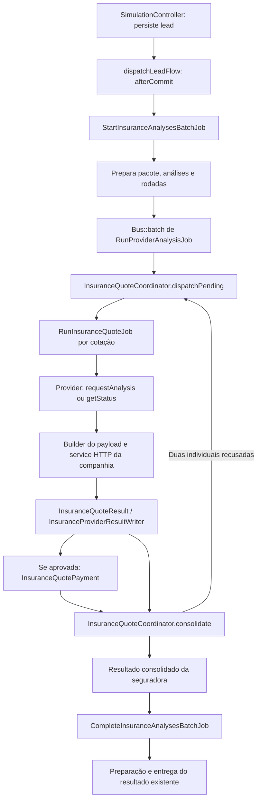

# Arquitetura das análises de seguro fiança

Referência da implementação em 29/10/2026. Este documento registra a arquitetura decidida e aplicada para orientar as próximas refatorações das APIs. As regras e evidências de cada seguradora permanecem no [ESTUDO_FIANCA_LOCATICIA.md](ESTUDO_FIANCA_LOCATICIA.md), especialmente na revisão de implementação de 29/10.

Antes de modificar builders, providers, services ou jobs, confrontar este documento com o código e com as decisões posteriores do usuário. Atualizar este registro quando uma mudança arquitetural for explicitamente adotada. Uma regra documentada ou componente implementado não equivale a homologação com a seguradora.

## 1. Decisão central: preservar o pacote e detalhar suas cotações

O sistema continua iniciando as seguradoras para um único lead e consolidando um resultado por companhia. A multiplicidade fica abaixo dessa análise consolidada, sem criar um cartão ou pacote independente para cada pretendente/plano.

| Nível | Model / tabela | Responsabilidade |
| --- | --- | --- |
| Pacote operacional | `InsuranceAnalysisBatch` / `lotes_analises_seguro` | Agrupar as análises do lead e coordenar a conclusão do pacote |
| Resultado da seguradora | `InsuranceAnalysis` / `analises_seguro` | Manter o resultado consolidado consumido pelo sistema existente |
| Rodada | `InsuranceAnalysisRound` / `insurance_analysis_rounds` | Identificar a tentativa por `attempt_id`, guardar snapshot e vigências |
| Execução da seguradora na rodada | `InsuranceProviderRun` / `insurance_provider_runs` | Reunir cenários, controlar conclusão e apontar `selected_quote_id` |
| Cenário de pretendentes | `InsuranceApplicantScenario` / `insurance_applicant_scenarios` | Distinguir `primary`, `spouse` e `joint` |
| Cotação efetiva | `InsuranceQuote` / `insurance_quotes` | Guardar plano, IDs remotos, status, payloads, pagamento e valor da parcela |
| Eventos da cotação | `InsuranceQuoteEvent` / `insurance_quote_events` | Preservar histórico próprio de cada cotação |

Uma rodada pode conter execuções de várias companhias. A análise consolidada continua existindo ao longo das rodadas; respostas antigas não devem sobrescrever a rodada corrente. Os identificadores remotos de cada tentativa pertencem à cotação, mesmo quando o resultado escolhido é projetado na análise consolidada por compatibilidade.

Migration: `database/migrations/2026_10_29_121802_create_insurance_quote_orchestration_tables.php`. Aplicação confirmada em 29/10: lote 12, `Ran`.

## 2. Fluxo de execução implementado

- `SimulationController::dispatchLeadFlow()` respeita a feature flag e evita iniciar outro pacote inicial quando já existe um para o lead. O fluxo de reanálise tem entrada própria.
- `StartInsuranceAnalysesBatchJob` prepara as execuções e mantém o batch dos jobs carregadores por companhia. Os jobs de cada cotação são despachados pelo coordenador; não presumir que o término do batch carregador signifique término das cotações.
- `RunProviderAnalysisJob` encaminha as novas execuções para o coordenador e preserva a compatibilidade dos registros antigos.
- `RunInsuranceQuoteJob` executa uma cotação, consulta seu andamento e busca pagamento após aprovação. Retomadas consultam a cotação existente quando há identificação remota.
- A conclusão do pacote possui proteção para aguardar as execuções correntes. Não enviar resultado final apenas porque os jobs carregadores terminaram.

## 3. Separação de responsabilidades

| Componente | Responsabilidade a preservar |
| --- | --- |
| `InsuranceQuoteCoordinator` | Preparar rodada/cenários/planos, despachar pendências, autorizar conjunta e consolidar vencedor |
| `InsuranceLeadSnapshot` | Capturar os dados da rodada e reconstruir o lead do cenário sem depender de alterações posteriores no cadastro |
| `InsuranceExecution` | Contrato comum dos models `InsuranceAnalysis` e `InsuranceQuote`, permitindo compatibilidade dos adapters |
| `InsuranceProviderInterface` e `InsuranceProviderResolver` | Resolver a seguradora e expor operações de análise/consulta sobre `InsuranceExecution` |
| Providers específicos | Conduzir as etapas e interpretar particularidades da companhia; não decidir quantos cenários ou planos executar |
| `Payloads/*PayloadBuilder` | Montar e validar o payload específico com dados do cenário, plano e condições da cotação |
| `TooService` / `PottencialService` | Autenticação, transporte HTTP e endpoints específicos; não escolher o melhor negócio global |
| `InsuranceProviderResultWriter` / `InsuranceQuoteResult` | Aplicar resultados e eventos na execução correta, respeitando a tentativa corrente |
| `InsuranceQuotePayment` | Consultar pagamentos e selecionar a condição da cotação, mantendo valor unitário e resposta de origem |
| `InsuranceAnalysisAttempt` | Impedir aplicação de respostas de tentativas obsoletas e proteger operações da rodada |
| `InsuranceAnalysisFailure` | Tratar falhas sem convertê-las em recusas de crédito |
| `AnalysisQuoteSummary` / `AnalysisQuoteComparison` | Normalizar preços e comparar condições elegíveis de maneira compartilhada |
| `InsuranceAnalysisReadService` / `InsuranceAnalysisPageService` | Carregar resultados locais e entregar dados autorizados, incluindo `quote_attempts` |
| `AnalysisResultPreparationService` | Reutilizar resumo/comparação na preparação dos resultados enviados |
| `LeadReanalysisService` | Iniciar nova rodada e novas solicitações conforme a regra geral de reanálise |

O domínio das seguradoras permanece em `app/Services/Insurance`, com adapters em `Providers` e builders em `Payloads`. Os demais domínios organizados em `Access`, `Dashboard`, `LeadLovers`, `Leads` e `Lookup` não devem receber lógica de protocolo de seguradora. Não usar o serviço legado `InsuranceAnalysisService` como um novo orquestrador paralelo ao coordenador.

## 4. Cenários, planos e limites

Sem cônjuge, criar o cenário `primary`. Com nome e CPF de cônjuge no snapshot, criar `primary` e `spouse`, com jobs independentes que podem executar em paralelo conforme os workers disponíveis.

A conjunta `joint` é criada uma única vez, na mesma companhia e rodada, somente quando **ambos os cenários individuais estão recusados**. Aprovação, processamento, análise manual, falha técnica ou ausência de parcela não autorizam essa terceira tentativa. Na Pottencial, um cenário individual só está recusado quando todos os seus planos estão recusados.

| Companhia | Planos por cenário | Sem cônjuge | Com cônjuge, inicialmente | Máximo com conjunta |
| --- | --- | --- | --- | --- |
| Pottencial | `Basic`, `Complete`, `Traditional` | 3 | 6 | 9 |
| Too | `default` | 1 | 2 | 3 |

Os planos Pottencial podem ter coberturas e preços distintos. Manter três cotações reais e seus resultados separados; não calcular localmente o preço de um plano a partir de outro. Uma aprovação em qualquer cenário impede a conjunta. Entre aprovadas com preço válido, selecionar a menor parcela; empate usa o ID da cotação como critério determinístico atual.

Tokio ainda não possui provider integrado. Sua inclusão deverá reutilizar esta arquitetura, adicionando suas particularidades de elegibilidade, payload, resultado e pagamento. O padrão atual Invoice/Boleto do coordenador atende Too/Pottencial e **não deve ser aplicado cegamente à Tokio**, que possui regras próprias de parceiro/faturamento e cartão.

## 5. Estados, pagamento e consolidação

Status da análise e disponibilidade de preço são informações distintas. `payment_status` acompanha a obtenção do pagamento (`pending`, `ready`, `unavailable`, `failed`); a falha de pagamento não apaga uma aprovação.

O coordenador aguarda cotações não terminais e pagamentos ainda pendentes das aprovadas. Ao consolidar:

- Havendo aprovação, a companhia pode concluir aprovada mesmo sem preço comparável.
- Todas recusadas resultam em recusa; ausência de aprovação com falhas técnicas não deve ser apresentada como recusa integral.
- O vencedor é uma cotação aprovada com parcela positiva. Sem preço elegível, `selected_quote_id` fica vazio; pode haver uma aprovada representativa no agregado, sem inventar vencedor ou valor.
- Falha de PDF não altera a decisão de crédito nem autoriza conjunta.

Pottencial seleciona 30 parcelas em Invoice/Boleto. Too seleciona Mensal, Sem entrada, 29 parcelas efetivas na base de 30 meses, com Fatura/Boleto por origem. Usar o valor unitário retornado; não dividir prêmio total nem descontar novamente uma parcela. O PDF Too terá quantidade-base 30 no POST, conforme o estudo, embora a seleção sem entrada tenha 29 parcelas efetivas.

A comparação entre companhias utiliza a parcela confirmada nas novas rodadas, considerando moeda e vigência. Registros antigos mantêm o tratamento legado: não comparar total antigo com parcela nova. Painel e e-mail devem consumir a mesma seleção persistida e o resumo compartilhado.

## 6. Snapshot, filas e segurança de retomada

- A rodada guarda snapshot criptografado e datas de início/fim: dia da análise até 30 meses, com `addMonthsNoOverflow`. Polling e planos não devem recalcular a vigência em outro dia.
- O snapshot reconstrói a identidade individual; o cenário do cônjuge não pode conservar nome/documento do principal. A data própria do cônjuge ainda é uma pendência de payload Too descrita no estudo.
- Payloads e respostas das cotações possuem casts criptografados. Não expor respostas técnicas ou credenciais em `quote_attempts`.
- A implementação atual exige **fila database na mesma conexão do banco da aplicação**. `dispatchPending()` registra o job e `dispatched_at` dentro da mesma transação, usando `beforeCommit()`. Não trocar por Redis/SQS ou alterar esse despacho sem redesenhar a garantia transacional.
- Locks e restrições de unicidade protegem rodada, cenário/plano e criação da conjunta. `WithoutOverlapping` protege o job por cotação; `attempt_id` e a geração `poll_count` descartam trabalho antigo ou repetido.
- Não repetir cegamente POST de criação após timeout quando o efeito remoto é desconhecido. A ausência de identificador após tentativa anterior exige tratamento explícito. A Too também registra o início da criação da cotação para evitar duplicação.
- Retry de consulta/pagamento não deve criar nova cotação. Reanálise solicitada pelo usuário é outra operação: nova rodada com novas solicitações, preservando o histórico.
- Métodos antigos `requestReanalysis` e endpoints dedicados podem continuar no legado/diagnóstico; sua existência não autoriza usá-los no novo fluxo normal.

## 7. Como refatorar as APIs sem romper a arquitetura

1. Ler este documento e as regras atuais da companhia no estudo; verificar o caminho novo e os consumidores legados antes de editar contratos.
2. Ajustar campos, escalas, validação, agentes, coberturas e fallbacks no builder/configuração da companhia. Consumir o cenário, plano e datas já preparados.
3. Acrescentar ou corrigir chamadas no service HTTP e as transições específicas no provider, sem mover a orquestração para controllers ou builders.
4. Adaptar normalização e seleção de pagamento preservando decisão de crédito, valores reais, IDs e histórico por cotação.
5. Vincular documentos à cotação/plano correspondente, com autorização de download; não substituir todos os documentos pelo PDF do vencedor.
6. Verificar os testes afetados: cenários 3/6/9, conjunta única, falha distinta de recusa, respostas antigas, retomadas, pagamento indisponível e seleção do menor valor. Acrescentar os casos específicos da companhia quando alterar seu contrato.

Não criar uma chamada síncrona independente no controller, um segundo coordenador por seguradora, uma análise agregada por plano, ou um loop de tentativas até aprovação. Preservar o pacote existente e suas regras de acesso, conclusão e destinatários.

## 8. Implementação versus próximas entregas

A estrutura de múltiplas cotações, os serviços de consulta de pagamento Too/Pottencial, o comparador por parcela e os DTOs de tentativas estão implementados. O arquivo `tests/Feature/InsuranceMultipleQuotesTest.php` cobre a orquestração; aprovação local não substitui testes integrados com MySQL, workers e seguradoras.

Permanecem pendentes: alinhamento completo dos payloads Too/Pottencial às novas regras, PDF Too por POST/Base64, documentos por plano, apresentação das tentativas e do vencedor nas views/e-mails, integração Tokio e sua associação de parceiros. A página Gerenciar seguradoras também é futura. Não classificar essas entregas como prontas apenas porque a infraestrutura compartilhada existe.
